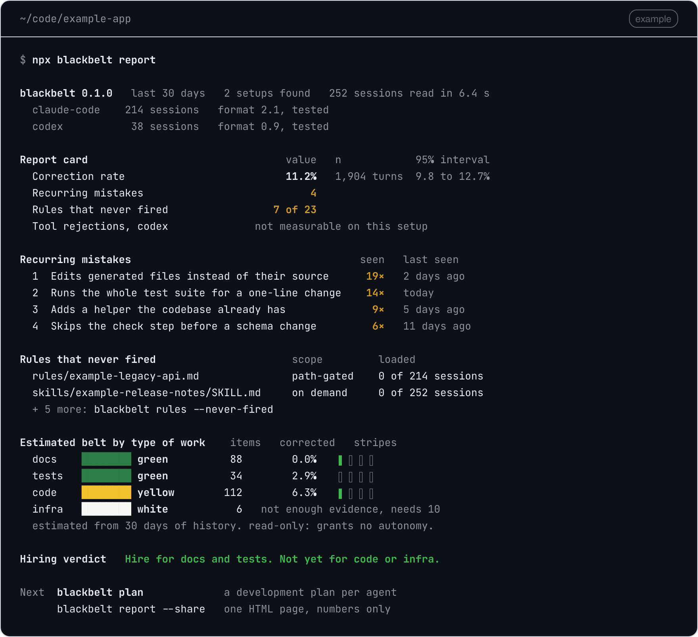
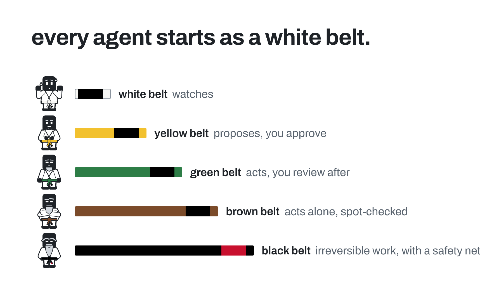

<div align="center">

<picture>
  <source media="(prefers-color-scheme: dark)" srcset="assets/logo-dark.png">
  
</picture>

<em>He watches. He trains. Nobody gets a belt for showing up.</em>

<h1>your agent is not a black belt. yet.</h1>

**blackbelt trains your AI agent on its own mistakes, from the transcripts already on your disk. Autonomy is earned one belt at a time.**

<a href="#roadmap"></a>
<a href="./LICENSE"></a>
<a href="#your-transcripts-stay-home"></a>

<sub>pre-release. this page describes 0.1 as designed.</sub>

</div>

<table align="center">
<tr>
<th align="left">week 0</th>
<th align="left">week 4, after his drills</th>
</tr>
<tr>
<td valign="top">you approve every edit.</td>
<td valign="top">you adopted 3 changes.<br>0 rolled back.</td>
</tr>
<tr>
<td valign="top">same mistake, every week.</td>
<td valign="top">edits to generated files: 19 → <b>2</b></td>
</tr>
<tr>
<td valign="top"><b>intake</b><br>green belt · docs and tests<br>7 of 23 rules never fired</td>
<td valign="top">code: yellow belt → <b>green belt</b></td>
</tr>
</table>

<div align="center">

**Same agent. Four weeks of practice.**

<sub>Example. Your numbers will come from your own transcripts.</sub>

Other tools add rules; blackbelt checks whether they work on your own work, and tells you when it can't tell.

</div>

<a id="install"></a>

```bash
npx blackbelt report
```

he'll be ready when he's ready. [watch the repo](https://github.com/thomas-moerman/blackbelt/subscription) to know first.

Built for Claude Code, Codex CLI, anything with OpenTelemetry, or any JSONL. One agent or a whole crew.

## how he trains

Diagnostic tools show what is wrong with your agent today. He is the coach: he works on it, week after week, and checks the result against evidence he does not write.

1. **intake.** `npx blackbelt report` reads the last 30 days: corrections, recurring mistakes, rules that never fired, an estimated belt per type of work. Free, local, no setup.
2. **plan.** A development plan per agent: what to learn next, in order.
3. **drills.** Built from your agent's own recurring mistakes. He runs them.
4. **progress.** Measured against your corrections, reverts and CI. A change that does not beat the noise floor never reaches you.
5. **you adopt.** `blackbelt adopt <change>`. One command. `blackbelt rollback` takes it back.
6. **he adopts alone** (0.2). Reversible changes only, after a sealed exam your agent never sees.
7. **belts earn autonomy** (0.3). Black belt, for irreversible work, comes later, with a safety net.

0.1 (in progress) covers steps 1 to 5. Any setup gets the intake, a plan and drills; training runs on Claude Code first.

## the intake

<!-- generated:demo -->
| intake, last 30 days | example |
|---|---|
| correction rate | 11.2% of 1,904 turns |
| recurring mistakes | 4. top: edits generated files instead of their source, 19× |
| rules that never fired | 7 of 23 |
| estimated belts | docs green, tests green, code yellow, infra white |
| verdict | hire for docs and tests. not yet for code or infra. |

<p align="center">
  <picture>
    <source media="(prefers-color-scheme: dark)" srcset="assets/report-card-dark.png">
    
  </picture>
</p>

<details>
<summary>the report card as text</summary>

```text
$ npx blackbelt report

blackbelt 0.1.0   last 30 days   2 setups found   252 sessions read in 6.4 s
  claude-code    214 sessions   format 2.1, tested
  codex           38 sessions   format 0.9, tested

Report card                                value   n            95% interval
  Correction rate                          11.2%   1,904 turns  9.8 to 12.7%
  Recurring mistakes                           4
  Rules that never fired                 7 of 23
  Tool rejections, codex              not measurable on this setup

Recurring mistakes                                     seen   last seen
  1  Edits generated files instead of their source      19×   2 days ago
  2  Runs the whole test suite for a one-line change    14×   today
  3  Adds a helper the codebase already has              9×   5 days ago
  4  Skips the check step before a schema change         6×   11 days ago

Rules that never fired                      scope         loaded
  rules/example-legacy-api.md               path-gated    0 of 214 sessions
  skills/example-release-notes/SKILL.md     on demand     0 of 252 sessions
  + 5 more: blackbelt rules --never-fired

Estimated belt by type of work    items   corrected   stripes
  docs    green           88        0.0%   1 of 4
  tests   green           34        2.9%   0 of 4
  code    yellow         112        6.3%   1 of 4
  infra   white            6   not enough evidence, needs 10
  estimated from 30 days of history. read-only: grants no autonomy.

Hiring verdict   Hire for docs and tests. Not yet for code or infra.

Next  blackbelt plan             a development plan per agent
      blackbelt report --share   one HTML page, numbers only
```

</details>
<!-- /generated:demo -->

<sub>Example: synthetic transcripts.</sub>

The first look. He reads the transcripts your agents already wrote and tells you where they stand: how often you had to step in, the mistakes that come back, the rules nobody used, and what he would trust them with today.

Free and local, always. `--share` will write one HTML page with numbers only. `blackbelt badge` will write your estimated belt as an SVG for your own README.

## the belts

<p align="center">
  <picture>
    <source media="(prefers-color-scheme: dark)" srcset="assets/belts-dark.png">
    
  </picture>
</p>

An entrustment ladder, not proof of skill. One belt per agent and type of work: green in docs, white in infra. Up one belt at a time, on evidence he did not write. Down at once when something breaks.

<!-- generated:belts -->
| belt | your agent may |
|---|---|
| white | watch. Nothing changes. |
| yellow | propose. You approve first. |
| green | act. You review after. |
| brown | act alone. He spot-checks. |
| black | irreversible work, with a safety net |

| belt | items | failed · corrected |
|---|---|---|
| yellow | 10 | 30% · 50% |
| green | 30 | 15% · 30% |
| brown | 60 | 8% · 15% |
| black | 100 | 4% · 8% |

<sub>Items: at least, in 28 days (black: 90). Failed and corrected: at most, as 95% upper bounds, so green needs zero failures in 30 items. Weekly checks in a row: 2, 2, 3, 4, yellow to black. Black also needs a dry run, canary, backup and a restore drill in the last 30 days.</sub>
<!-- /generated:belts -->

Stripes show how close the next belt is. One serious incident: straight back to yellow belt. Reversible work tops out at brown. Black is only for work you mark irreversible. Until 0.3, belts are estimates. They grant nothing. With 30 days of history the highest estimate is green.

## what he checks

<!-- generated:measures -->
| check | what it tells you |
|---|---|
| correction rate | how often a human had to stop or overrule the agent<br>needs: human turns |
| recurring mistakes | the same mistake, grouped: how often, when last<br>needs: human turns |
| rules that never fired | rules, skills and instructions unused in 30 days<br>needs: rule load events |
| estimated belt | what your evidence supports, per type of work<br>needs: 10+ items |
| hiring verdict | what to trust the agent with, today<br>needs: 20+ sessions |
| coverage | what your setup lets him measure, and what not<br>needs: nothing |
<!-- /generated:measures -->

## he grades the rules too

His training loop is inspired by Argyris & Schön's double-loop learning ([the 1978 book](https://openlibrary.org/books/OL4565877M)): when a mistake comes back, question the rule, not only the work.

Whether rules help at all is an open question. In one study, context files did not generally improve coding agents' success rates, and they raised the cost ([Gloaguen et al., 2026](https://arxiv.org/abs/2602.11988)). A preprint reports modest evidence the other way: rule files raised pass rates, random rules as much as curated ones ([Zhang et al., 2026](https://arxiv.org/abs/2604.11088)).

0.1 (in progress), report only. The intake lists the rules that never fired. Also:

- **contradicted rules.** You keep correcting what a rule asks for: the rule may be wrong. You keep restating a rule: it may be ignored, and may need to be a hook or a test. Candidates, never verdicts. ([#18](https://github.com/thomas-moerman/blackbelt/issues/18))
- **his own track record.** Every change you adopted: held, rolled back, followed by worse outcomes, or unknown. Labelled "observational, no control group". ([#19](https://github.com/thomas-moerman/blackbelt/issues/19))
- **rule wording.** How many rules say "don't", how many say "do". A label, not advice: one preprint saw "don't" rules help and "do" rules hurt in a small rule set, and its authors call that suggestive ([Zhang et al., 2026](https://arxiv.org/abs/2604.11088)). ([#20](https://github.com/thomas-moerman/blackbelt/issues/20))
- **does your context earn its place.** Replay drills with your rules and without them. An unsealed estimate until the sealed exam (0.2), and "inconclusive" when he can't tell. ([#21](https://github.com/thomas-moerman/blackbelt/issues/21))

He shows the numbers. Nothing changes without them.

## honest numbers

- Every number shows its n and a 95% interval.
- Can't measure it on your setup? It says "not measurable". Never 0.
- Fewer than 20 sessions? "not enough evidence".
- A change counts only above the measured noise floor, over 3+ runs per task.
- His own drills never count toward a belt. Only your corrections, reverts, CI and incidents do.
- Until the sealed exam ships (0.2), results say "dev set (visible)".
- Every number on this page is an example until a benchmark with its method exists.

<!-- generated:stats -->
Benchmark numbers arrive with 0.1, with their method. Until then: nothing to show, so nothing shown.
<!-- /generated:stats -->

## works with

Single agent, subagents, a whole crew. No roles assumed. No file layout assumed.

<!-- generated:setups -->
| setup | 0.1 (in progress) |
|---|---|
| Claude Code | intake, plans, drills, training |
| Codex CLI | intake, plans and drills (read-only: no training yet) |
| any framework with OpenTelemetry | intake, plans and drills (read-only), via OTLP-JSON import |
| anything else | intake, plans and drills (read-only), via canonical JSONL |
| Copilot CLI, Cursor, Gemini, OpenCode, Cline | planned |
<!-- /generated:setups -->

## what he never touches

- Your permissions, hooks, tool or harness settings.
- Your agent's own memory.
- Anything irreversible, before black belt and its safety net.
- Your files, without a commit he can roll back. In 0.1 you adopt every change yourself.

## your transcripts stay home

- Runs on your machine. Sends nothing unless you say so.
- Stores no transcript text. Kept locally as text: plan goal titles, his notes on your agent, and a drill's scrubbed copy of your request (file mode 0600, 180 days). The stored copy never leaves your machine. During a drill, the scrubbed request is sent to your agent's model, the same way your agent already works, and only with your consent.
- The share page will hold numbers only. It has no place for text, and a test will plant fake secrets in fake transcripts to prove none get through.
- Anything bound for a model provider asks first: one manifest per run, with what goes where and the cost. Unattended cycles need a standing consent you set. Paid runs stop at EUR 10 per cycle unless you change it.
- `blackbelt purge` will delete everything he kept.

## commands

<!-- generated:commands -->
0.1 (in progress):

- `blackbelt report` · the intake report card (the default)
- `blackbelt report --share` · one HTML page, numbers only
- `blackbelt badge` · your estimated belt as an SVG, written locally
- `blackbelt plan` · a development plan per agent
- `blackbelt train --dry-run` · plan, drills and cost; spends nothing
- `blackbelt train` · one training cycle
- `blackbelt adopt <change>` · apply a change that passed its exam
- `blackbelt rollback <id>` · undo a change (or `--last`, `--since <date>`)
- `blackbelt pause`, `blackbelt resume` · stop and restart all training
- `blackbelt rules` · every rule, and whether it fired
- `blackbelt drills list` · the drills he built from your mistakes
- `blackbelt status` · what he sees and what he is doing
- `blackbelt label` · check his correction detector against you
- `blackbelt memory list` · what he remembers about your agent
- `blackbelt purge` · delete everything he stored
<!-- /generated:commands -->

## roadmap

- **0.1, you hold the pen** (in progress): intake report card, estimated belts, a plan per agent, drills from your own mistakes, changes you adopt, rollback, pause; report-only rule checks: contradicted rules ([#18](https://github.com/thomas-moerman/blackbelt/issues/18)), his own track record ([#19](https://github.com/thomas-moerman/blackbelt/issues/19)), a rule-wording label ([#20](https://github.com/thomas-moerman/blackbelt/issues/20)), an unsealed context check ([#21](https://github.com/thomas-moerman/blackbelt/issues/21)).
- **0.2, he adopts alone:** a sealed exam your agent never sees; he adopts reversible changes on his own; once a month, in a sealed exam week, he asks whether he would hire your agent again; a foundation memo, where he questions the target itself.
- **0.3, earned belts:** belts unlock autonomy, yellow to brown; group ablation tests which rules earn their place.
- **0.4+:** black belt for irreversible work, with a safety net.

## questions

**Does he change my agent on his own?**
Not in 0.1. You adopt every change, and rollback takes it back. From 0.2 he adopts reversible changes alone, after a sealed exam.

**A belt per agent?**
Per agent and per type of work: docs, tests, code, deps, ci, infra, data migrations, sending.

**API key?**
Not for the intake. Training calls models on your key, with a hard budget: EUR 10 per cycle unless you change it.

**Why belts?**
"Autonomy level 3" means nothing. Everyone knows a white belt from a black belt.

## help

Most wanted, once 0.1 lands: an adapter for a setup he can't read yet. Any language: canonical JSONL against the event schema (planned), synthetic fixtures only, never real transcripts. A contributing guide is planned.

## license

[Apache-2.0](LICENSE). Use it at work. Fork it. Ship it.

---

<p align="center"><b>Autonomy costs evidence. A star costs one click.</b></p>

<p align="center"><sub><a href="./docs/adr">design decisions</a> · <a href="https://github.com/thomas-moerman/blackbelt/issues">issues</a></sub></p>
